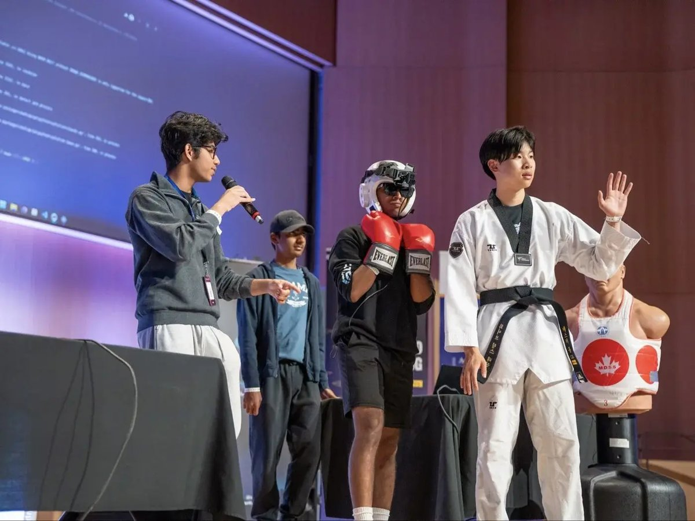
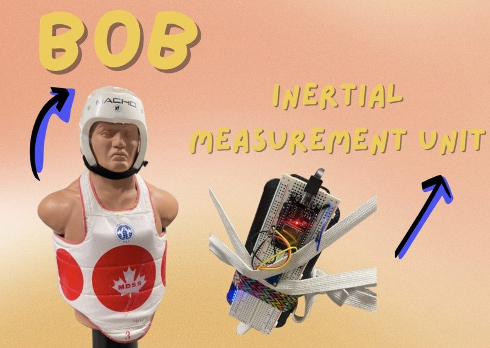

# Coach Bob

An AR warm-up game for combat sports. Put on the AR glasses and helmet, and Coach Bob tells you which strike to throw next while shouting playful insults to get you moving.

<p align="center">
  
  
</p>

**Devpost:** https://devpost.com/software/coach-bob

## What it does

- Lights up targets on Bob, the training dummy, through the AR glasses: kick, knee, hook, jab, or straight, to the head or body
- Coach Bob talks to you while you warm up
- Senses each hit from how Bob wobbles after impact
- Shows speed, force, and time on a dashboard afterwards

## How it works

- **XReal glasses:** show the targets, placed with OpenCV
- **OAK-1 AF camera:** first-person video from the helmet
- **Gemini and ElevenLabs:** write and voice Coach Bob's lines
- **MPU-6050 on an ESP32:** registers hits and measures their force

## Tech

depthai, mediapipe, opencv, gemini, elevenlabs

## Structure

```
oak_cam.py           game loop: camera, pose detection, targets
campaign.json        boss order and stats
cutscenes/           boss intro videos
fetch_damage.py      reads hits and health from the ESP32
esp32_simulator.py   fakes the ESP32 for testing
```
